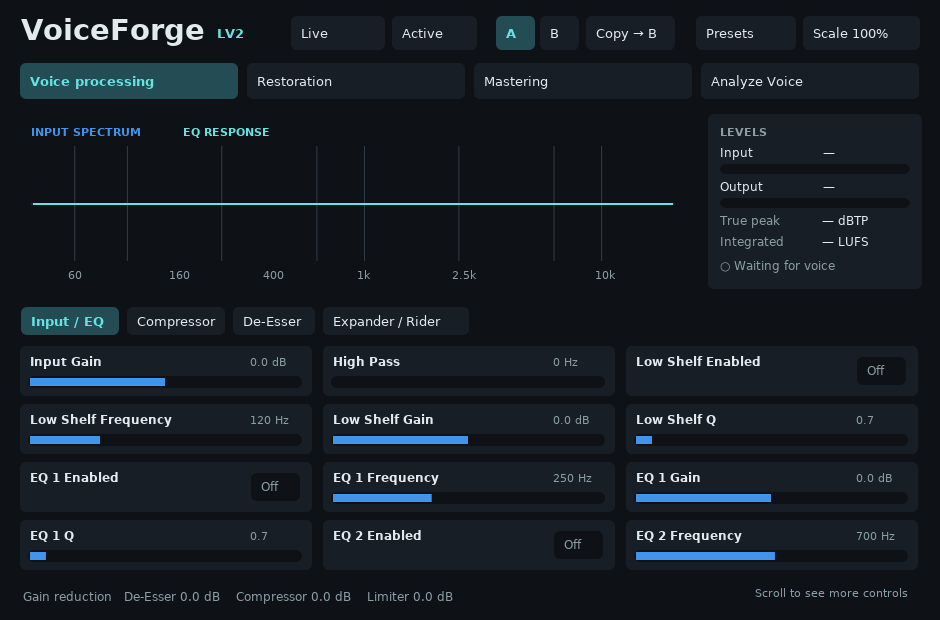

# VoiceForge LV2

VoiceForge LV2 ist ein Offline-Sprachprozessor für Ardour unter Debian. Die Vorabversion 0.4.0 enthält Mono und Stereo, Pegelregler, Hochpass, Sechsband-EQ, Expander, De-Esser, De-Plosive, Kompressor, Level Rider und Sample-Peak-Limiter. Studio ergänzt De-Click und spektrale Rauschreduktion. Live meldet null zusätzliche Samples Verzögerung.

Die eigene Oberfläche zeigt Eingangsspektrum, EQ-Kurve, Pegel, Gain Reduction, True Peak und LUFS. Sie enthält zehn Werkspresets, lokale eigene Presets, speicherbare A/B-Sätze und eine geführte Sprachanalyse.



## Installation und Verwendung

Das Debian-Paket und das Benutzerarchiv werden nach erfolgreichem Build und Installationstest im [Debian-Workflow](https://github.com/weikiboy-tech/voiceforge-lv2/actions) bereitgestellt. Für die Installation und Verwendung in Ardour siehe [Installation](docs/installation.md).

## Build

Debian-Basis ist Bookworm. Die benötigten Pakete stehen im [Dockerfile](packaging/debian/Dockerfile). Unter Debian erzeugt `sh scripts/build.sh` das getestete Bundle und `sh scripts/package.sh` die Installationsartefakte.

Unter Windows kann der C++20-DSP-Kern mit einem Visual-Studio-CMake-Generator gebaut werden.

```powershell
cmake -S . -B build-win -DVOICEFORGE_LV2=OFF
cmake --build build-win --config Release
ctest --test-dir build-win -C Release --output-on-failure
```

Die [Testdokumentation](docs/testing.md) nennt den Prüfstand für Debian und Ardour. Die Hardwareprüfung am Zielrechner steht aus. Dereverb bleibt zurückgestellt, bis eine Implementierung die Klangprüfung besteht.
